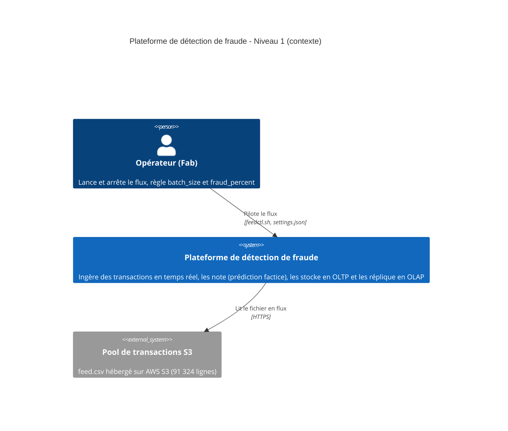
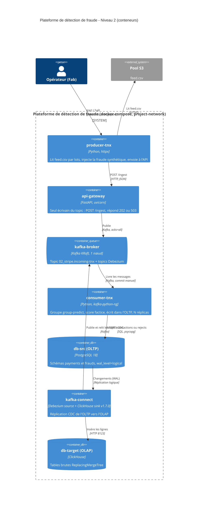

# kafka02 — réplication PostgreSQL → PostgreSQL avec Debezium et Kafka

## Objectif

### Architecture - niveau 1 (contexte)



### Architecture - niveau 2 (conteneurs)




Tous les services sont sur un même réseau Docker, nommé `<$PROJECT_NAME>`).

|

## Ordre de création et dépendances

`
```

« healthy » signifie que le test de santé (`healthcheck`) du service est passé. `init` termine à l'état `Exited (0)` : c'est normal.

Scripts d'initialisation des bases, exécutés une seule fois à la création d'une base vide, dans l'ordre alphabétique :

- `./db-src/` : `01_role.sh` (rôle `debezium`), `02_schemas.sql` (schéma et tables), `03_permissions.sh` (droits), `04_publications.sh` (publication)
- `./db-target/` : création des tables cibles (`01_create_table_customers.sql`)

## Options figées pour l'instant

Les variables sont dans `.env`, sauf mention contraire.

### Kafka (cluster, nœud, ports)


### Topics


### Connect et connecteur


### Bases de données

| Option | Valeur | Variable / fichier |
|---|---|---|
| Version PostgreSQL | 18.4 | image `postgres:18.4-bookworm` |
| Journal logique | `wal_level=logical` | `command:` du service `db-src` |
| Slots de réplication maximum | 5 | `max_replication_slots`, `command:` de `db-src` |
| WAL conservé au maximum par slot | 10 Go | `max_slot_wal_keep_size`, `command:` de `db-src` |
| Source : base et schéma | `postgres`, `inventory` | `DB_SRC_NAME`, `DB_SRC_SCHEMA` |
| Source : rôle de Debezium | `debezium` | `DEBEZIUM_USER` |
| Cible : base | `dbtarget` | `DB_TARGET_NAME` |

### Consumer


### Accès depuis l'hôte (127.0.0.1 uniquement)


### Persistance

# Commandes

- relance du projet et reconstruction  des bases + conteneurs
docker compose up -d --build

- Arrêt des conteneurs + suppression + suppression des volumes nommés
docker compose down -v --remove-orphans
