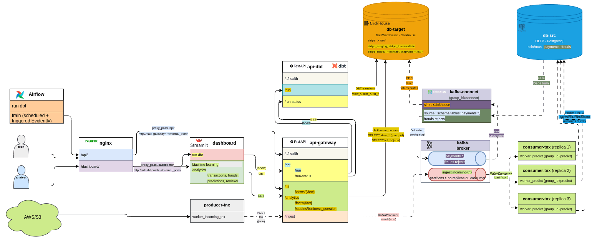

# Stripe - Système de détection de fraude bancaire temps réel par prédiction

## Objectif

Système de paiement de type Stripe avec détection de fraude : les transactions PostgreSQL sont répliquées en temps réel (CDC avec Debezium et Kafka) vers ClickHouse, puis transformées avec dbt en tables analytiques et en jeux de données d'entraînement ML.
Une API FastAPI expose ces données à un dashboard Streamlit, qui permet d'analyser les fraudes et la revue manuelle des transactions.

### Architecture - niveau 2 (conteneurs)

Tous les services sont sur un même réseau Docker, nommé `<$PROJECT_NAME>`).

## 🛠️ Stack technique

**Données**

![Debezium](https://img.shields.io/badge/Debezium-231F20?style=for-the-badge&logo=data:image/png+xml;base64,iVBORw0KGgoAAAANSUhEUgAAABoAAAAaCAYAAACpSkzOAAAAAXNSR0IB2cksfwAAAARnQU1BAACxjwv8YQUAAAAgY0hSTQAAeiYAAICEAAD6AAAAgOgAAHUwAADqYAAAOpgAABdwnLpRPAAAAAlwSFlzAAST4AAEk+ABiAINbwAAAAd0SU1FB+oLCRAKGx1/bskAAARwSURBVEjHfZZriBdVGMafmXnOumoXSehCqGF3U1q1i+Ltg6GWWIZZWQSSWAqbrq4E1pdCCDHF3fIS+TG8pMKKt1AIMsmSdtet1V0JKdnsQhSJ5npp53n6MOO67n/+DcyX4Znze+ec83vPRPXHJxvXX+cB7IVRs3jE538AwOrWGbvs5BmBkAME/iuzUeay1TM2Hzl/phNvN9UuFZI1WYYQgmV2yKxLFdfHKL1uBDDHUbS/rnUaAeQvdkMgM8gcK/Bgze559wPInl+DwGZkc4jBtYgqFhWBYESwOTpFMqEbdA3SE9xf4IJrmW5IjwwhsIZlIHkoGZQ9YxEEAuE8c/WLSiEBMgfHAC4UQwiBffNqO4sg+UCVeeafMhAIRAxgTxkI5FCVVRv2FEOI1Bxe++07kcCDMq8UQeQMVGNEzQUQCOG5FcfmDhDibQLXy8HXZwghDDEqpq19dPlpgfNlXuwNkYkIANYen0qZE2UOEthXDg8LYbbMgTK3S3yp4nLftLPSw21WCayQOVQIM+XwkMzTKTiuacsXv1bNmXaHnEwQQr8e0+0IZa4VLXMHyOFjgbPlcEBgTSqeXPnIqu5MTeN7McRqIayR+UuKUN3lZN+mMfN7u4lodeuMBpnZzsoquCCEPanj7XKIjbBf4BSZEtgqh458LZpkrv/hUPu5oRNHLjJCfV79z3I4IfOSwDMyN+x4pbo9ev/7mS5Z5OyFD1NwkR0ekNkmMOrtSQq2yhwnhwsGWwUO6+lTPk6nzClxGQjkUG1zWGqezL6kVEabIwwu3DhmgVKHXQUQyOwncHVcBgKBkc2RK0evghw6io0PkDk6F/bHom2djzeKMrsEssgTI+mTy3jFKCdjUpFlwhUjKYJAIGOBzeVklMNdebVN5YyXw+B5X22DkDTLdAEkE1YOywReLIUQMp9d2rgylrkuBY8XTo1ZlUa81+AJgesKizaRnDh0qmP0rJEN+eL+LoTTMiuFcJMRbpX5Z/uBlsO33D14s8FzMv8WeEoOF2XeJoRY5j2puU3gZwbb7HBZ4Cmb7TbbBbYVClvb+G5sh+lyWC/w9tSsNbh+w+MLdTXz6tdbIYf7ZNYLYZrM7Sn4+qcTnjgLl/iK6K3m2rk2kZpwNi2dQnK4paHxt+Ezx99p84gQBss8kTo0CPxJDpeF5JjNNkVMJG4R+Lwc/pK5UwjfZePwjMBDeyc92BUtb3rTvU5GpJnVr21+bMknL3zz0QyDu69XICBf+A9SJUschZvlcErgQJUq0Czzybg3JG9HlTY3vXh0wxA42Ze3kt47LpK52BFnbRs/+azMnQUQ2BwFRPVx+eM39JHDlI1j50sOx/9HxqfzM6ulAAJnB8R0ysHu7mMlMvYHgNS8VCrs1S2cZbImmhRBAOCGOOu25WRkfsTnU4eif4YsI7CjDAQAEMusKwe5CpK5Ie/ChTJmxSRfCqGpCJKBUFEnc+m1iq5vsACw4+U32mVOFXhUDl29dyAA7Jk0rEvmU0a0Nf8JTXve/wFewS0MV8l85QAAAABJRU5ErkJggg==)

![Apache Airflow](https://img.shields.io/badge/Apache_Airflow-FFFFFF?style=for-the-badge&logo=data:image/svg+xml;base64,PHN2ZyB2aWV3Qm94PSIwIDAgNTEyIDUxMiIgeG1sbnM9Imh0dHA6Ly93d3cudzMub3JnLzIwMDAvc3ZnIiBmaWxsLXJ1bGU9ImV2ZW5vZGQiIGNsaXAtcnVsZT0iZXZlbm9kZCIgc3Ryb2tlLWxpbmVqb2luPSJyb3VuZCIgc3Ryb2tlLW1pdGVybGltaXQ9IjIiPjxwYXRoIGQ9Ik0xNC4wNjggNTA0LjAwOEwyNTMuNDg2IDI1OC42MmMxLjUyOS0xLjUwMyAxLjY5OS0zLjg5OC41MS01LjY1Ni0xNC41MjMtMjAuMzI0LTQxLjQ0Ni0yMy44NDktNTEuMzgzLTM3LjUwNS0yOS40Ny00MC40NTItMzYuOTQ1LTYzLjM1LTQ5LjYtNjEuOTMxYTMuNzExIDMuNzExIDAgMDAtMi4yOTIgMS4yMTRsLTg2LjU0NCA4OC42NUMxNC40OTMgMjk0LjM1IDcuMzYgNDA2LjY3IDYgNTAwLjczdi4wMTdjMCAyLjU3MyAyLjEyMyA0LjY4OCA0LjY3MSA0LjY4OCAxLjM2IDAgMi41NDgtLjUxIDMuMzk3LTEuNDI3eiIgZmlsbD0iIzAxN2NlZSIgZmlsbC1ydWxlPSJub256ZXJvIi8+PHBhdGggZD0iTTUwMy45NDUgNDk3Ljk1M2wtMjQ1LjM2My0yMzkuNDFhNC40OCA0LjQ4IDAgMDAtNS42OS0uNTM0Yy0yMC4yOTkgMTQuNTY1LTIzLjg2NiA0MS40Mi0zNy40NTUgNTEuMzc0LTQwLjUxMSAyOS40ODctNjMuMzU3IDM2Ljk3LTYxLjk5OCA0OS42NDEuMTcuODg0LjU5NCAxLjY5IDEuMjczIDIuMjkzbDg4LjY2NyA4Ni40NzZjNTAuOTU4IDQ5Ljc1MiAxNjMuMjM2IDU2LjkwMyAyNTcuMjUzIDU4LjE5NCAyLjYzMyAwIDQuNzU2LTIuMTE1IDQuNzU2LTQuNjg4YTQuNTkgNC41OSAwIDAwLTEuNDQzLTMuMzQ2eiIgZmlsbD0iIzAwYWQ0NiIgZmlsbC1ydWxlPSJub256ZXJvIi8+PHBhdGggZD0iTTI0My4zOCA0NDcuODE5Yy0yNy44NTgtMjcuMTc4LTQwLjc2Ny04MC45MzkgMTIuNTY5LTE5MS43OTgtODYuNzEzIDM4Ljc4OC0xMTcuMTE4IDg5Ljc3MS0xMDIuMTcgMTA0LjM3bDg5LjYgODcuNDI4eiIgZmlsbD0iIzA0ZDY1OSIgZmlsbC1ydWxlPSJub256ZXJvIi8+PHBhdGggZD0iTTQ5Ny45MTUgOC4wMjZMMjU4LjU4MiAyNTMuNDE0Yy0xLjUyOSAxLjUwMy0xLjc4NCAzLjg5OC0uNTk1IDUuNjU2IDE0LjYwOCAyMC4zMjQgNDEuNDQ2IDIzLjg0OSA1MS4zODMgMzcuNTA1IDI5LjQ3IDQwLjQ1MiAzNy4wMyA2My4zNSA0OS42ODQgNjEuOTMxLjg1LS4xMjcgMS42OTktLjU1MiAyLjI5My0xLjIxNGw4Ni40NTktODguNjVjNDkuNzY5LTUwLjk1OCA1Ni45MDMtMTYzLjI3OCA1OC4xNzctMjU3LjMzOHYtLjAwOWMwLTIuNTczLTIuMTIzLTQuNjk2LTQuNjcxLTQuNjk2LTEuMjc0IDAtMi40NjMuNTE4LTMuMzk3IDEuNDI3eiIgZmlsbD0iIzAwYzdkNCIgZmlsbC1ydWxlPSJub256ZXJvIi8+PHBhdGggZD0iTTQ0Ny44MDYgMjY4LjY0MmMtMjcuMTc4IDI3Ljg1Ny04MC45MzggNDAuNzY2LTE5MS43NzItMTIuNjIgMzguNzI4IDg2Ljc5IDg5Ljc3MSAxMTcuMjAzIDEwNC4zNzkgMTAyLjI0Nmw4Ny4zOTMtODkuNjI2eiIgZmlsbD0iIzExZTFlZSIgZmlsbC1ydWxlPSJub256ZXJvIi8+PHBhdGggZD0iTTcuOTUzIDE0LjA4MWwyNDUuMzYzIDIzOS4zODRhNC40OCA0LjQ4IDAgMDA1LjY5LjUzNWMyMC4yOTktMTQuNTY2IDIzLjg2Ni00MS40MiAzNy41NC01MS4zNzQgNDAuNDI2LTI5LjQ4OCA2My4yNzItMzYuOTcgNjEuOTE0LTQ5LjY0Mi0uMTctLjg4My0uNTk1LTEuNjk4LTEuMjc0LTIuMzAxbC04OC41ODItODYuNDc2QzIxNy42NDYgMTQuNDU1IDEwNS4yODQgNy4zMDQgMTEuMjY2IDYuMDEzaC0uMDg1Yy0yLjU0OCAwLTQuNjcxIDIuMTE1LTQuNjcxIDQuNjg4IDAgMS4yNzQuNTEgMi40OTcgMS40NDMgMy4zOHoiIGZpbGw9IiNlNDM5MjEiIGZpbGwtcnVsZT0ibm9uemVybyIvPjxwYXRoIGQ9Ik0yNjguNjA0IDY0LjIxNWMyNy44NTcgMjcuMTc4IDQwLjc2NiA4MC45MzktMTIuNjU1IDE5MS44MDYgODYuNzk4LTM4Ljc4NyAxMTcuMjAzLTg5Ljc4IDEwMi4yNTYtMTA0LjM3bC04OS42MDEtODcuNDM2eiIgZmlsbD0iI2ZmNzU1NyIvPjxwYXRoIGQ9Ik02NC4yNjIgMjQzLjRjMjcuMTc4LTI3Ljg1NiA4MC44NTMtNDAuNzY2IDE5MS43NzIgMTIuNjIxLTM4LjgxMy04Ni43OS04OS43NzEtMTE3LjIwMy0xMDQuMzc5LTEwMi4yNDdsLTg3LjM5MyA4OS42Mjd6IiBmaWxsPSIjMGNiNmZmIiBmaWxsLXJ1bGU9Im5vbnplcm8iLz48Y2lyY2xlIGN4PSIxLjI2IiBjeT0iMS4yNiIgcj0iMS4yNiIgZmlsbD0iIzRhNDg0OCIgdHJhbnNmb3JtPSJ0cmFuc2xhdGUoMjQ1LjMzMyAyNDUuMjc4KSBzY2FsZSg4LjQ5MykiLz48L3N2Zz4=)

**Application**

**Infrastructure**

