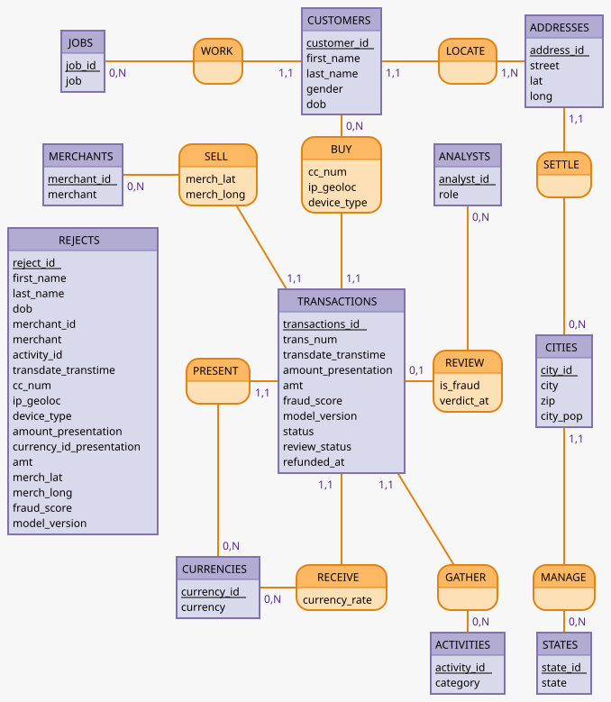

# ADR 001 — Modèle OLTP du système de paiement et de détection de fraude

- **Date** : 2026-10-02
- **Voir aussi** : [ADR 002](002-adaptation-csv-schema-oltp.md) (adaptation du CSV à ce modèle)

## 1. Contexte

Le modèle proposé dans le MCD permet la représentation de transactions bancaires entre des marchands et des clients.
Le modèle doit pouvoir représenter :
- des paiements dans **plusieurs devises**,
- un **score de fraude** calculé à l'enregistrement, avec rejet immédiat des transactions prédites frauduleuses conservées dans un schéma à part,
- la **validation par un analyste** des cas litigieux,
- un client qui paie avec une ou plusieurs cartes éventuellement partagées,
- un marchand qui a une localisation variable,
- des transactions faites dans des devises différentes,
- la possibilité d'un remboursement après une transaction frauduleuse (ex: usurpation d'identité),
- le type d'appareil utilisé pour le paiement.

La base sera remplie avec des données provenant d'un dataset (en csv) de transactions frauduleuses qui ne contient pas toutes les données attendues dans le schéma. Certains arbitrages seront faits pour l'importation, depuis le csv, des données existantes. Une partie des données sera conservée pour l'alimentation future du système pour simuler un système en production.

## 2. Décisions

### 2.1 Deux schémas séparés

| Schéma | Contenu | Règle |
|---|---|---|
| `payments` | Tables pour : clients, marchands, devises, transactions, ... |
| `frauds` | Table pour les tentatives rejetées directement par le modèle |

- Une transaction prédite frauduleuse n'entre **jamais** dans `PAYMENTS.TRANSACTIONS` : elle est écrite dans `FRAUDS.REJECTS`. Seules les transactions valides ou litigieuses entrent dans `TRANSACTIONS`.
- `REJECTS` est un journal des tentatives même si le client ou le marchand change ou disparaît ensuite. Il garde donc ses propres `cc_num`, `ip_geoloc`, `device_type`.

### 2.2 Multi-devises

| Propriété | Portée par | Sens |
|---|---|---|
| `amount_presentation` | `TRANSACTIONS` (et `REJECTS`) | Montant affiché au client, dans la devise de présentation (association `present`). Toujours connu, même si le paiement est refusé |
| `currency_rate` | association `receive` | montant encaissé = `amount_presentation` * `currency_rate`. Vaut 1 (par défaut dans ce projet) |
| `amt` | `TRANSACTIONS` | Montant de référence en monnaie commune, pour comparer les transactions entre elles |

- Deux associations vers `CURRENCIES` : `present` (devise présentée) et `receive` (devise de règlement).
- Le montant reçu n'est pas stocké : il se calcule par `amount_presentation` * `currency_rate`.
- La monnaie commune de `amt` doit être nommée une fois dans la documentation de la colonne.
- dans notre cas, le csv n'a qu'une devise de référence, donc `currency_rate` sera de 1

### 2.3 Validation par un analyste

Le système score une transaction entrante, écarte les transactions prédites frauduleuses mais enregisre les transactions litigieuses en conservant leur score. Un analyste peut faire une revue manuelle des transactions litigieuses pour confirmer ou infirmer leur statut.
  
- Association `review` entre `TRANSACTIONS` et `ANALYSTS` : (0,1) côté transaction, (0,n) côté analyste.
- `review` porte `is_fraud` (verdict) et `verdict_at` (date du verdict). `analyst_id`, `is_fraud` et `verdict_at` sont **nullables ensemble** : une transaction jamais revue n'a ni analyste, ni verdict, ni date.
- `review_status` suit le cycle de vie : `cleared` (jugée légitime à l'enregistrement), `pending` (attente d'un analyste), `reviewed` (analysée). Les transactions importées depuis le csv auront une valeur `init`.
- Règles `CHECK` (règles vérifiées par la base à chaque écriture) :
  - `verdict_at IS NULL OR analyst_id IS NOT NULL` ;
  - `analyst_id IS NULL OR is_fraud IS NOT NULL`.

### 2.4 `cc_num` porté par l'association `buy`

On prévoit qu'un client puisse payer avec plusieurs cartes et que certaines de ses cartes puissent servir à d'autres clients. Donc le client ne conserve  pas la trace des cartes utilisées. Or la carte **n'est pas non pllus une entité** : elle n'a aucune propriété propre, elle n'existe que par son numéro au moment du paiement. Donc on fait porter le numéro de la carte par l'association client-transaction : un client réalise une transaction avec une carte.

- `cc_num`, `ip_geoloc` et `device_type` décrivent comment *ce client* a payé *cette fois* : ils sont portés par `buy` (client–transaction).
- Conséquence : `cc_num` ne sert donc jamais à identifier un client.

### 2.5 Position du marchand portée par `sell`

Pour savoir où se trouvait le marchand au moment de la vente, on fait porter ses coordonnées par l'association marchand-transaction. `merch_lat` et `merch_long` sont portées par l'association `sell` (marchand–transaction)
- Le modèle peut ainsi représenter un marchand mobile ou en ligne.

### 2.6 Adresse, ville, état

- Chaîne normalisée : `CUSTOMERS` → `ADDRESSES` → `CITIES` → `STATES`. `JOBS` et `ACTIVITIES` sont aussi des tables de référence.
- **Choix** : `zip` et `city_pop` sont dans `CITIES`. Une ville découpée en plusieurs zips donne plusieurs lignes, chacune avec sa population, sans table de quartier. Ce choix déroge à la normalisation avec un coût faible.

## 3. Conséquences

- Toutes les associations qui portent des propriétés sont (0,n)-(1,1) ou (0,n)-(0,1) vers `TRANSACTIONS` sont intégrées comme colonne de `TRANSACTIONS` dans le MLD : une association devient des colonnes, pas une table.
- Les règles `CHECK` et les index partiels (file de revue `review_status = 'pending'`, extraction `is_fraud = 1`) sont à écrire dans le DDL final.
