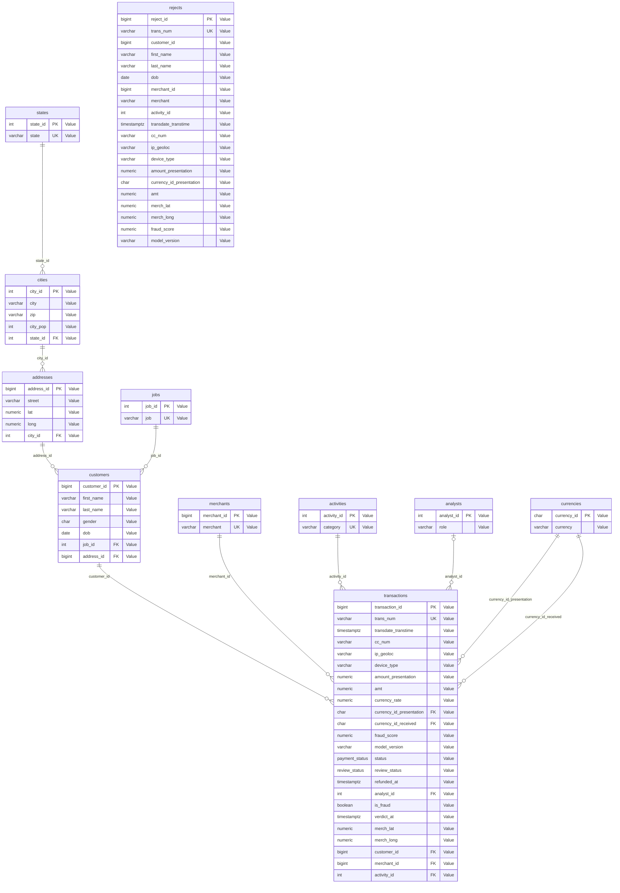

# ADR 002 — Adaptation du CSV `transactions.csv` au schéma OLTP

- **Date** : 2026-10-03
- **Dépend de** : [ADR 001](001-modele-oltp-fraude.md) (modèle visé)

> Cet ADR ne parle que du CSV. Il deviendra caduc le jour où une source réelle remplacera ce jeu de données ; l'ADR 001, lui, reste valable.

## 1. Contexte

Le CSV (23 colonnes, dont un index sans nom) est une table à plat. Il n'a ni identifiants de client ou de marchand, ni devise, ni statut de paiement, ni score de fraude, ni analyste. Il doit alimenter le schéma de l'ADR 0001 sous forme relationnelle, et servir à la fois :
- de **jeu d'entraînement** du modèle de détection ;
- de **réserve de transactions « prod »**, pour simuler de nouvelles écritures dans l'OLTP.

## 2. Décisions

### 2.1. Statut valide/frauduleux des transactions alimentant la base initiale

Concerne :
Entités / Associations : `TRANSACTIONS`, `REVIEW`, `ANALYSTS`
Propriétés: `is_fraud`, `analyst_id`, `verdict_at`, `role`, `review_status`, `fraud_score`, `model_version`

**En prod, les transactions sont prédites puis soit effectuées soit rejetées**

Le dataset sera coupé en une partie qui servira à l'import et à l'entraînement initial et une réserve pour simuler les conditions de production pour alimenter en nouvelles transactions à prédire.
`TRANSACTIONS` contient les transactions valides.

Initialisation de la base :

- `is_fraud = 0|1` : les transactions dans transactions sont considérées déjà revues individuellement. Certaines transactions ont été labellisées frauduleuses (`is_fraud = 1`) et les autres sont valides (`is_fraud = 0`). On garde ces valeurs et on considère qu'elles sont le résultat de la revue par un analyste fictif (`analyst_id = 0`), à une date de revue fictive (`verdict_at` = `transdate_transtime`). Cette date n'intervient pas dans le futur entraînement du modèle.
- `analyst_id = 0` : analyste fictif pour les revues.
- `role = init` : rôle de cet analyste fictif.
- `review_status = init` : statut de la revue d'une transaction litigieuse. Les transactions initiales sont considérées revues par un analyste. En prod, `review_status = pending|reviewed`.
- `fraud_score = NULL` : on ne peut pas donner un score pour des transactions qui n'ont pas été prédites. De plus, ce score n'intervient pas dans le futur entraînement du modèle.
- `model_version = NULL`.

### 2.2 Une seule devise

Concerne :
Entités / Associations: `CURRENCIES`, `RECEIVE`, `TRANSACTIONS`
Propriétés : `currency_id`, `currency_rate`, `amt`, `amount_presentation`

- `CURRENCIES` reçoit une ligne **USD** (les données sont américaines donc on considère que les données sont en $). Elle sert aux deux FK (`present` et `receive`), qui sont NOT_NULL.
- `currency_rate` vaut 1 ou reste nul.
- `amt` et `amount_presentation` reçoivent la même valeur (colonne CSV `amt`). 

### 2.3 Numéro de carte et identification du client

Concerne :
Entités / Associations: `CUSTOMERS`, `BUY`, `TRANSACTIONS`
Propriétés : `cc_num`, `first_name`, `last_name`, `dob`

- Le modèle prévoit plusieurs cartes par client et plusieurs clients par carte (ADR 001), mais on choisit de ne pas transformer la carte en entité. Ce sera une propriété de l'association buy.

    Cette commande montre qu'il n'y a ni client avec plusieurs cartes, ni carte partagée :

    `SELECT
           (SELECT count(*) FROM (SELECT 1 FROM '<PATH_TO_FILE>/transactions.csv'
              GROUP BY "first", "last", dob HAVING count(DISTINCT cc_num) > 1)) AS clients_avec_plusieurs_cartes,
           (SELECT count(*) FROM (SELECT 1 FROM '<PATH_TO_FILE>/transactions.csv'
              GROUP BY cc_num HAVING count(DISTINCT ("first", "last", dob)) > 1)) AS cartes_partagees;`

- Le dédoublonnage des clients se fait sur le triplet (`first_name`, `last_name`, `dob`) : c'est l'identité du client, on n'utilise pas la carte comme identifiant.

### 2.4 Marchands

Concerne :
Entités / Associations: `SELL`, `MERCHANTS`, `ACTIVITIES`, `TRANSACTIONS`
Propriétés : `merch_lat`, `merch_long`, `activity_id`, `category`

Mesure sur le CSV : La localisation des marchands change à chaque vente.
- C'est une particularité du jeu de données : elle ne locacalise pas fiablement le marchand.

    Cette commande montre qu'il y a autant de positions par marchand qu'il effectue de transactions:

    `SELECT merchant, count(*) AS nb_lignes, count(DISTINCT (merch_lat, merch_long)) AS nb_positions
    FROM '<PATH_TO_FILE>/transactions.csv'
    GROUP BY merchant
    HAVING count(DISTINCT (merch_lat, merch_long)) > 1
    ORDER BY nb_positions DESC
    LIMIT 20;`

- Les marchands peuvent plusieurs catégories qui varient en fonction des transactions effectuées. L'activité du marchand (`category`) est donc reliée à la transaction par une entité `ACTIVITIES` liée à `TRANSACTIONS` par la relation `GATHER`.
  
    Visualiser le nombre de marchands avec plusieurs catégories :

    `(SELECT count(*) FROM (SELECT 1 FROM '<PATH_TO_FILE>/transactions.csv' GROUP BY merchant    HAVING count(DISTINCT category) > 1)) AS marchands_multi_categories;`

### 2.5 Identifiants fabriqués et clés de dédoublonnage

Le CSV n'a aucun identifiant : la base les génère. Le CSV sert seulement à repérer les doublons.

| Table | Clé de dédoublonnage |
|---|---|
| `TRANSACTIONS` | `trans_num` (à déclarer `UNIQUE`) |
| `CUSTOMERS` | (`first`, `last`, `dob`) |
| `ADDRESSES` | (`street`, `lat`, `long`, ville) |
| `CITIES` | (`city`, `state`, `zip`) — la ville seule ne suffit pas, puisque `zip` est dans `CITIES` |
| `STATES`, `JOBS`, `MERCHANTS`, `ACTIVITIES` | `state`, `job`, `merchant`, `category` |

- Les dimensions (clients, marchands, etc.) sont importées sur **le CSV entier**, puis seules les `TRANSACTIONS` sont réparties entre entraînement et réserve (les FK `NOT NULL` l'exigent).
- Ordre d'import : `STATES` → `CITIES` → `ADDRESSES` → `JOBS` → `CUSTOMERS` → `ACTIVITIES` → `MERCHANTS` → `CURRENCIES` → `ANALYSTS` → `TRANSACTIONS`.
- Aucun doublon de transaction n'est attendu : `trans_num` est UNIQUE et importé du CSV. En production, ce serait une valeur générée sans doublon possible (indice incrémental ou autre).

### 2.6 Découpage entraînement / réserve

- Découpage par **date** (entraînement = passé, réserve = futur), pour ressembler à la production.
  
  Cette commande montre que les dates sont comprises entre 2020-06-21 12:14:25 et 2020-12-31 23:59:34.

  `SELECT min(CAST(trans_date_trans_time AS TIMESTAMP)) AS date_min, max(CAST(trans_date_trans_time AS TIMESTAMP)) AS date_max FROM '<PATH_TO_FILE>/transactions.csv';`

  Répartition par mois : le dernier mois concentre le double de transactions de la moyenne. C'est ce mois qu'on va couper en 2.

  ` SELECT date_trunc('month', CAST(trans_date_trans_time AS TIMESTAMP)) AS mois, count(*) AS nb_lignes, sum(is_fraud) AS nb_fraudes FROM '<PATH_TO_FILE>/transactions.csv' GROUP BY mois ORDER BY mois;`

  Coupure au 12/12/2020 OO:00:00 : init / réserve : 464395 / 91324 - fraudes 2037 / 108

  ` SELECT CASE WHEN CAST(trans_date_trans_time AS TIMESTAMP) < TIMESTAMP '2020-12-12 00:00:00' THEN 'init' ELSE 'reserve' END AS partie, count(*) AS nb_lignes, sum(is_fraud) AS nb_fraudes, min(CAST(trans_date_trans_time AS TIMESTAMP)) AS date_min, max(CAST(trans_date_trans_time AS TIMESTAMP)) AS date_max FROM '<PATH_TO_FILE>/transactions.csv' GROUP BY partie ORDER BY partie;`

  Nombre de nouveaux clients et marchands dans la réserve : 1 / 0. C'est dérisoire mais on garde tout de même la possibilité de pouvoir à terme générer des marchands synthétiques ou des clients synthétiques dont les transactions seront des cas litigieux ou frauduleux. D'ailleurs le système en prod doit pouvoir anticiper des proportions différentes de clients et de marchands problématiques.

  `SELECT 'clients' AS dimension, count(*) AS nouveaux_dans_reserve FROM (  SELECT "first", "last", dob FROM '<PATH_TO_FILE>/transactions.csv' WHERE CAST(trans_date_trans_time AS TIMESTAMP) >= TIMESTAMP '2020-12-12 00:00:00'  EXCEPT  SELECT "first", "last", dob FROM '<PATH_TO_FILE>/transactions.csv' WHERE CAST(trans_date_trans_time AS TIMESTAMP) < TIMESTAMP '2020-12-12 00:00:00') UNION ALL SELECT 'marchands', count(*) FROM (  SELECT merchant FROM '<PATH_TO_FILE>/transactions.csv' WHERE CAST(trans_date_trans_time AS TIMESTAMP) >= TIMESTAMP '2020-12-12 00:00:00'  EXCEPT  SELECT merchant FROM '<PATH_TO_FILE>/transactions.csv' WHERE CAST(trans_date_trans_time AS TIMESTAMP) < TIMESTAMP '2020-12-12 00:00:00');`

### 2.7 Colonnes vides à l'import et valeurs posées

- **`REJECTS` n'est pas alimenté par l'import** : le CSV n'a pas de score de fraude. La prédiction l'écrira.

### 2.8 Colonnes du CSV non reprises ou particulières

- L'index sans nom n'est pas importé.
- `unix_time` est redondant avec `trans_date_trans_time` et incohérent sur la ligne 0 (1371816865 = 21 juin 2013, contre le 21 juin 2020 pour la date).

    Cette commande permet de vérifier qu'il y a un écart constant entre `unix_time` et `trans_date_trans_time` :
    
    `SELECT count(*) AS nb_lignes,
    count(*) FILTER (WHERE ecart = 0) AS lignes_coherentes,
    count(DISTINCT ecart) AS nb_ecarts_distincts,
    min(ecart) AS ecart_min,
    max(ecart) AS ecart_max,
    min(d) AS date_min,
    max(d) AS date_max
    FROM 
        (SELECT CAST(trans_date_trans_time AS TIMESTAMP) AS d,
        epoch(CAST(trans_date_trans_time AS TIMESTAMP)) - unix_time AS ecart
        FROM 'transactions.csv');`

    L'écart = 220 924 800s, soit 2557 jours, c'est-à-dire 7 ans (2013-06-21 → 2020-06-21, avec 2 années bissextiles).
    `unix_time` est donc la date décalée de 7 ans, sans information propre, pas même sur le fuseau.
    **Décision** : on ne l'importe pas.

- `trans_date_trans_time` n'a pas de fuseau horaire : le type de la colonne (`timestamptz` ou `timestamp`) est à fixer au DBML, pour POSTGRESQL, avec `SET TIME ZONE 'UTC'` pour que l'import utilise UTC et pas le fuseau de la session (par défaut s'il n'est pas précisé).
- Les noms de marchands gardent leur préfixe `fraud_` (il fait partie de la valeur).

### 2.9 Colonnes obligatoires car features du modèle

Concerne :
Entités / Associations : `CUSTOMERS`, `WORK`, `SELL`, `TRANSACTIONS`
Propriétés : `gender`, `job_id`, `merch_lat`, `merch_long`

Ces quatre colonnes sont NOT NULL : le modèle les utilise comme variables d'entrée (features), une transaction sans l'une d'elles ne peut pas être scorée.

### Rejects

La table frauds.rejects enregistre les transactions prédites frauduleuses par le modèle qui a été utilisé pour ce traitement.