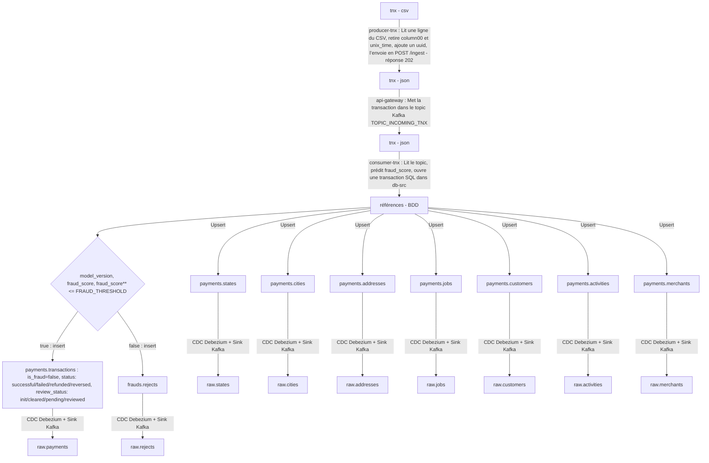

# ADR 003 — Gestion d'une transaction entrante

- **Date** : 2026-10-03
- **Dépend de** : [ADR 003]

## 1. Contexte

Le système mime un système en prod. Une transaction est scorée en fonction des paramètres qui la composent.

## 2. Décisions

### 2.1. INSERT conditionnel : COMMIT ou ROLLBACK

Une nouvelle transaction ainsi que les insertions associées (client, marchand, ...) est COMMIT si la transaction est scorée valide ou litigieuse, mais ROLLBACK si elle est frauduleuse. À ce moment est consignée dans les rejets.

 (valides - `status cleared` ou litigieuses - `status pending`) et enregistrées dans le schéma `payments`.

`status` : cycle de vie du paiement

| Valeur | Sens | Écrite aujourd'hui ? |
|---|---|---|
| `successful` | Paiement accepté | Oui, par le consumer, toujours |
| `failed` | Paiement échoué | Non |
| `refunded` | Paiement remboursé | Non |
| `reversed` | Paiement annulé (rétrofacturation) | Non |

`review_status` : état du contrôle anti-fraude

| Ligne | review_status | is_fraud | analyst_id | verdict_at |
|---|---|---|---|---|
| Origine CSV | `init` | valeur d'origine | 0 | transdate_transtime |
| Acceptée par le modèle | `cleared` | false | NULL | NULL |
| Litigieuse en attente | `pending` | NULL | NULL | NULL |
| Litigieuse relue | `reviewed` | verdict de l'analyste | renseigné | renseigné |
| Rejetée (frauds.rejects) | — | true (calculé dans dbt) | — | — |