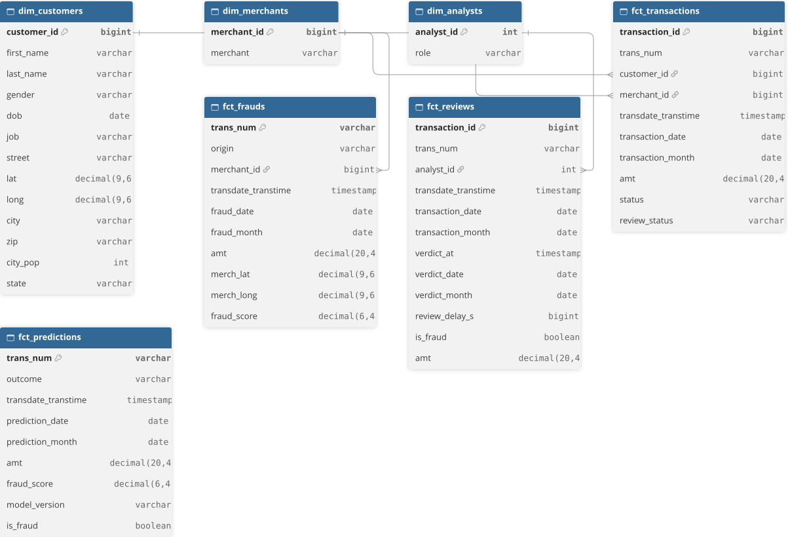

# ADR_011 — OLAP : définition des besoins et conception du schéma

Besoin : partir des questions auxquelles le système doit pouvoir répondre, pour définir la structure des tables de dimensions et de faits.

## Contexte

### Questions business :
1. Métriques de revenu : Quel est le revenu mensuel par marchand ?
2. Segmentation client : Quelle est la part de clients par zone géographique ?
3. Performance produit : Quel est le volume de transactions par période ?

### Analyse de fraude :
4. Quelle est la quantité de fraudes par jour, par mois ?
5. Quel est le montant de la fraude par marchand (évitée ou subie) par mois ?
6. Quel est le montant de la fraude (évitée ou subie) par mois, en fonction de la distance (entre ip_geoloc et coordonnées du marchand) ? (ip_geoloc est prévu mais jamais alimenté, et le POC ne le produit pas donc ne peut pas encore répondre à cette question)

### Monitoring des performances du modèle :
7. Quel est le ratio entre les prédictions valides (cleared+pending) vs rejects ?
8. Quel est le ratio rejet inline vs fraude manuellement validée ?
9. Quel est le ratio des fraudes manuellement validées vs fraudes manuellement invalidées ?

### Audit des reviews :
10. Combien de transactions ont été revues manuellement par analyste par période ?
11. Quel est le délai moyen entre transaction_datetime et verdict_at par analyste, par période ?

## Faits

Événements distincts :
1, 2, 3 -> transaction
4, 5, 6, 8 -> fraude
7, 9 -> prédiction
10, 11 -> revue

## Dimensions par question

1. Transaction : merchants, date (mois)	-> somme de amt
2. Transaction : customers (state) -> nombre de clients distincts
3. Transaction : date -> nombre des lignes
4. Fraude : date (jour, mois) -> nombre de lignes
5. Fraude : distance client (customers) - lieu de transaction -> somme de amt
6. Question écartée pour l'instant
7. Prédiction : date -> résultat (rejet, cleared, pending, reviewed), fraud_score
8. Fraude -> origine (rejet inline ou review)
9. Prédiction -> review_status, is_fraud
10. Revue : analysts, date (période) -> nombre de lignes
11. Revue : analysts, date (période) -> délai entre transdate_transtime et verdict_at

## Faits avec dimensions

- Transactions : merchants, date, customers
- Frauds : date, merchants, transactions (merch_lat et merch_long en attributs du fait)
- Predictions : date
- Reviews : analysts, date

## Types et contraintes sur les dimensions et les faits

Les tables proviennent des tables raw, elles-mêmes transformées par DBT par staging/raw/stg_raw__*.sql  
Ces tables raw proviennent de la création de ces tables pour suivre le CDC via db-target/sql/10_raw_tables_from_dbsrc.sql  
Les types proviennent de ces tables et transitent par CDC en String pour de nombreuses colonnes.  
Les cast sont faits soit par les transformations stp_raw__*.sql, soit seront faits dans les transformations fct_*.sql ou dim_*.sql.  
